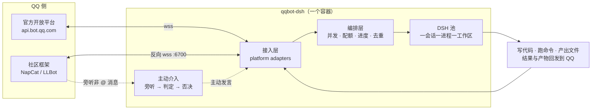

# qqbot-dsh

> **把 DeepSeek Harness（DSH）接进 QQ。** 一个服务、多个出口、会主动说话的群聊 agent。

## 核心能力

| | 能力 | 一句话 |
|---|---|---|
| ⚙️ | **完整 agent 能力** | 内核是 [DSH](https://www.npmjs.com/package/@deepseek-ai/dsh)：每个会话一个独立进程 + 独立工作区，能真的写代码、跑命令、读文件、多步干活并交付产物 |
| 🔌 | **一套服务，多套出口** | 官方开放平台与社区框架（OneBot v11）**可同时在线**，接入差异全部收在适配器里，编排层以上只有一条代码路径 |
| 💬 | **主动发言** | 不只对 @ 反应：旁听群聊 → 判断该不该开口 → 五类场景主动插话，带限流、发言预算、「没人理我就停」等硬闸门 |
| 🎭 | **可切换的人设前台** | 管理员发 `/persona <名>` 即可切换该会话的应答风格，**下一条消息生效、无需重启** |
| 🐳 | **Compose 一键部署** | 只支持 Docker：配置随仓库提供（带注释、**不用复制**），起步只有「填 `.env` → `docker compose up -d --build`」两步 |
| 💾 | **数据持久化** | 会话记忆、每会话工作区、QQ 登录态与设备标识全部落在命名卷，升级 / 重启 / 重建容器不丢 |
| 🔒 | **安全隔离** | 容器加固（只读根文件系统、`cap_drop: ALL`、非 root、资源上限）+ workspace-write 沙箱；管理端口只绑回环，密钥通过受权限保护的 env 文件注入、不入库 |



| 通道 | 接入方式 | 旁听（听得到没 @ 的消息） | 主动发言 |
|---|---|---|---|
| **官方开放平台** `qq-official` | 主动 wss 连出 api.bot.qq.com，需审核 | 需开通「接收所有消息」能力 | ❌ 平台不支持（主动推送已停用、群聊每月 4 条） |
| **社区框架** `onebot` | 反向 WebSocket 连入 `:6700`，**免审核** | ✅ | ✅ |

---

## 部署

两条路线二选一，命令细节一律见对应手册，这里不重复。

### 路线一：本地部署（本机 / 手头已有服务器）

框架（NapCat / LLBot）跑在宿主的形态，适合本机试跑。

```sh
cp .env.example .env          # 至少填 DEEPSEEK_API_KEY；走官方通道再加 QQ_APP_ID / QQ_APP_SECRET
docker compose up -d --build
docker compose logs -f
```

- 走社区框架：在框架里加一条**反向 WebSocket** 指向 `ws://127.0.0.1:6700/onebot/v11/ws`，token 与 `ONEBOT_ACCESS_TOKEN` 一致（端口默认只绑 loopback，不对局域网开放）；
- 行为参数在 `qqbot.yml` + `config/*.yml`（带注释，改完 `restart` 生效），密钥与个人标识只写在 `.env`；
- 可选主动发言：`.env` 填 `BOT_LISTEN_GROUPS`（它同时决定被 @ 时的观察范围）与 `BOT_PROACTIVE_ENABLED`，默认先灰度观察；它会在什么情况下开口见 [SCENES.md](src/pipeline/proactive/interests/SCENES.md)；
- 可选换 / 加模型提供商：在 `config/local/models.yml`（不进 git，机制见 [config/local/README.md](config/local/README.md)）的 `models:` 段声明路由，密钥以 `apiKeyEnv` 引用、值写进 `.env`（内联密钥启动期直接拒绝）；
- **完整步骤、框架选型、常见坑与调参：[docs/DEPLOY.md](docs/DEPLOY.md)**。

### 路线二：云服务部署（云主机一体化，无需外部电脑）

在一台 Linux 云主机上，用同一套 Compose 把 **qqbot 与 NapCat 编排为同栈的 sidecar 容器**：QQ 登录态、设备标识、NapCat 配置持久化在独立卷，容器重建身份不变；管理端口（8080 / 6700 / 6099）只绑回环，不启用 `privileged`。

- **配置建议**：4 核 4G + 2GB swap、磁盘 ≥20GB 为推荐配置；2 核 4G 为可运行下限（需限制 DSH 并发，构建镜像时先停服务）；
- 云覆盖层只做三件事：置空本机代理依赖、补 90s 优雅停机宽限、端口与卷按云上形态收口；只用 NapCat 时 `.env` 设 `BOT_CONNECTORS=onebot`；
- 数据迁移按「先停旧 → 加密批次备份（SHA-256 清单）→ 新主机恢复 → 再启动」执行，全程禁止源云双跑；
- **详细命令、迁移、备份与回滚：[docs/CLOUD-DEPLOY.md](docs/CLOUD-DEPLOY.md)**。

> ⚠️ 诚实边界：云端链路（镜像构建 / 拉取、NapCat 扫码登录、消息收发、卷备份恢复）**尚未实测**，上线前请按 CLOUD-DEPLOY 的验证清单在云主机完成。社区框架基于 NTQQ 协议，存在账号风控风险（换设备、换出口 IP 是主要变量，跨云迁移尽量一次到位），平台风控只能降低概率、不承诺零风险，**建议用专门小号**。

---

## 它特别处理了什么

QQ 机器人的约束比看起来紧得多。挑五条最有代表性的（完整清单见 [DESIGN](docs/DESIGN.md)）：

| 平台约束 | 处理方式 |
|---|---|
| 被动窗口只有**群聊 5 分钟 / 单聊 60 分钟**，每条消息最多回 **5 / 4 次** | 回复配额账本 + 进度回执，永远给最终答案留配额；`msg_seq` 统一分配避免平台去重 |
| `session/prompt` **没有 resume 语义**，进程重启必失忆 | 桥接层自维护对话记录，runtime 重建时按边界标记回放——升级 / 重启不丢记忆 |
| 被 @ 时**看不到群里刚才在聊什么**，上下文里的 `[图片: x.jpg]` 只是占位 | 观察窗口静默记录白名单群消息（纯内存、不落盘）；被 @ 时注入当前话题，并按配额真实下载最近的图 / 文件 |
| **长截图**整张缩下去读不出、超限图被 runtime 整条拒收 | 长图按像素预算**原生分辨率切片**；超限图先探测真实像素再降采样重编码，只有解不开的才不内联 |
| 用户发来的**文件**是字节、模型读不了；一轮多产物会刷屏 | 落 `inbox/` 供 agent 深挖 + 抽取正文（PDF 走 `pdftotext`）；一轮多个文件自动打包成单个 zip 回发 |

## 权限模型（请务必了解）

**workspace-write + 无人值守审批桩**：agent 在工作区内可自由读写执行；工作区之外由沙箱挡住；无头环境里的审批由桩自动放行。

⚠️ **关键前提**：沙箱需要可用后端（Linux 上 `bwrap` 或 `Landlock`）。两者都不可用时，`workspace-write` 会退化为**事实上的完全访问**——此时容器本身（只读根文件系统、`cap_drop: ALL`、资源上限、非 root）才是真正的边界。确认你的部署属于哪种：

```sh
docker compose run --rm --entrypoint node qqbot scripts/verify-sandbox-capability.mjs
```

`SANDBOX-EFFECTIVE` = 边界有效；`DEGRADED` = 已降级（处置见 [DEPLOY 第 5 节](docs/DEPLOY.md)）。
残余风险（agent 可执行任意代码并出网、API Key 在容器内可见）见 [DESIGN 6.4](docs/DESIGN.md)。

---

## 文档

| 文档 | 内容 |
|---|---|
| [docs/DEPLOY.md](docs/DEPLOY.md) | **本地部署手册**：从零到跑通，含框架选型与调参建议 |
| [docs/CLOUD-DEPLOY.md](docs/CLOUD-DEPLOY.md) | **云服务部署手册**：资源建议、NapCat 同机编排、加密迁移、备份与回滚、上线验证清单 |
| [docs/CONFIG.md](docs/CONFIG.md) | 配置模块手册（怎么加模块、怎么排查） |
| [docs/DESIGN.md](docs/DESIGN.md) | 方案设计：架构、多接入模型、协议契约、硬约束落地、权限与安全 |
| [docs/RUNBOOK.md](docs/RUNBOOK.md) | 排障手册：按症状组织的排查流程（主动发言见 §5） |
| [SCENES.md](src/pipeline/proactive/interests/SCENES.md) | 主动介入场景的自然语言真相源：什么情况下会说、典型对话、红线 |
| docs/ 其余 | 需求与架构过程文档（主动介入、话题会话、富媒体等） |

## 开发

```sh
npm install
npm run typecheck
npm test                 # 离线单测：不触网、不启动 DSH 子进程
```

**改了东西要怎么生效**（没有热更新，但只有改后端代码才需要重建镜像）：

| 改动 | 命令 | 重建镜像 |
|---|---|---|
| `src/**` 后端代码 | `docker compose up -d --build` | 是 |
| `.env`（密钥 / 开关 / 白名单） | `docker compose up -d` | 否 |
| `qqbot.yml`、`config/**`、`interests.yml`（挂载的配置） | `docker compose restart qqbot` | 否 |
| 某个会话的规矩（工作区里的 `AGENTS.md`） | 直接写文件，连重启都不用 | 否 |
| 某个会话的人设风格（`/persona <名>` 命令） | 群里发命令，下一条消息生效 | 否 |

> `.env` 是**容器创建时**注入的：`restart` 不会重读它，所以那一行必须是 `up -d`。
> **永远不需要 `docker compose down`**。想跳过镜像构建调试：用 `docker-compose.dev.yml`
> 挂本地 `dist`（见 [DEPLOY 第 8 节](docs/DEPLOY.md)）。

### 容器内验证脚本（需要真实 `DEEPSEEK_API_KEY`，会调用一次模型）

```sh
docker compose run --rm --entrypoint node qqbot scripts/smoke-dsh.mjs       # 端到端驱动一轮 DSH
docker compose run --rm --entrypoint node qqbot scripts/smoke-web-fetch.mjs # 验证 web_fetch 真能抓到正文
docker compose run --rm --entrypoint node qqbot scripts/verify-sandbox.mjs  # 判定沙箱是否真闸
```

## 目录结构

```
docker-compose.yml         生产部署入口（qqbot.yml / config / interests.yml 以只读方式挂进来）
docker-compose.cloud.yml   云部署覆盖：置空代理、90s 停机宽限、端口收口
docker-compose.napcat.yml  NapCat sidecar：同栈容器、独立持久卷、端口仅回环
docker-compose.dev.yml     开发覆盖：挂本地 dist，跳过镜像重建
.env.example               密钥与个人标识样例（不含行为参数）
qqbot.yml + config/        配置入口与共享模块（接入 / 运行时 / 富媒体 / 交互 / 主动发言 / 谷时段）
config/local/              本机配置（模型路由、个人覆盖；*.yml 不进 git）
interests.yml              兴趣池（场景 5；独立 schema）
dsh-profile/               DSH profile 补丁 + 自动审批桩 + /persona 人设预设
src/                       后端源码：接入适配（adapters）/ 编排（pipeline）/ DSH 桥接（dsh）/
                           持久化与观察窗口（store）/ 配置合并与校验（config*.ts）
scripts/                   容器入口、云上 preflight（cloud-preflight.sh）、
                           卷批次备份恢复（volume-bundle.sh）与验证脚本
tests/                     离线单测（793 条）
docs/                      方案设计 / 本地部署 / 云部署 / 排障 / 配置手册
```

## 许可与来源

依赖 [@deepseek-ai/dsh](https://www.npmjs.com/package/@deepseek-ai/dsh)（MIT）。
QQ 协议实现依据**实况官方文档**（<https://bot.q.qq.com/wiki/develop/api-v2/>），
不使用已停更的 `tencent-connect/bot-docs` 作为依据——详见 [DESIGN 第 9 节](docs/DESIGN.md)。
