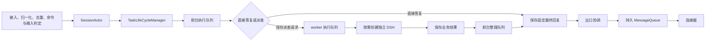

# 现行架构

每个有效输入和已授权的主动请求创建一个 Task，先由唯一前台 agent 理解和答复。需要业务工具或多步执行时，前台保存 worker 派发请求后结束本回合；worker 按需创建独立 DSH 实例，结果保存后再由前台组织最终回复。前台和 worker 共用同一模型路由，默认显式使用 `high`。固定快慢双 lane 属于历史方案，见 ADR-005、ADR-006；现行行为由 V3 契约和[ADR-017](adr/017-frontend-events-dynamic-worker.md) 约束。

## Task、调度与状态所有权

唯一运行入口是 `src/main.ts`。SessionActor 负责同会话事件顺序、输入关联和短事务；调度器持有队列、并发额度及取消信号，长执行、媒体准备和上传均释放 Actor。每个 Session 同时只运行一个前台回合，首次前台与结果整理交替安排，跨 Session 轮转；同 Session 的 worker 串行。取消及排队截止时间处理无需等待模型执行额度。

TaskLifeCycleManager 独占执行状态：保存派发请求、接受回执、执行身份、worker 结果、整理次数、最终回复和入队确认。worker 派发保存成功后才能返回稳定 worker ID；同 Task 的相同规范化请求返回已有回执，不同请求返回冲突。前台成功派发后立即退出。回执丢失、前台随后超时或断线时检查持久状态，已经接受的 worker 继续执行。Task、前台 job 和 worker 分别绑定身份，取消和迟到结果均按身份核对。

整体状态继续使用 `pending / running / completed / failed / cancelled`，阶段表达首次前台、等待 worker、worker 执行、等待整理、整理执行和回复入队。完成业务、完成整理、完成入队分别记录；MessageQueue 独占实际投递状态。最终回复以稳定 reply ID 保存并幂等入队，确认入队后结算 Task，消息实际送达独立推进。已经固定的回复遇到保存或入队故障只补保存、补入队，不再调用模型重写。

前台首次回合只开放 `query_tasks`、`cancel_task`、`start_worker`，默认最多 3 个模型 step、每回合 30 秒。尚未接受 worker 的前台超时直接失败，不自动派发。worker 只获得业务工具及所属工作区，不能直接取得连接器和回复接口，也不能再派发 worker；内部子代理前台等待。原始请求、附件引用、业务约束及已有控制操作由服务端加入交接，超过容量明确拒绝，禁止截断。

worker 结果同时保存执行分类、完整正文、证据、附件及未完成事项，并原子进入待整理阶段。失败、超时、中断和结果未知均形成结果。进程与交付物收尾后释放 worker 名额；等待整理不占 worker 容量。worker 提前结束时，结果先保存，等首次前台退出后再领取整理。

整理回合读取原始请求、交接、完整结果、经过校验的附件和当前角色卡，不开放业务及派发工具。空正文、非法结果、材料超出模型容量或需要交付却静默均记整理失败。最多执行两个整理回合，仅可重试的模型、初始化和超时故障允许再试一次；耗尽后固定失败说明，Task 记为 failed，原始业务结果和附件保留供查询，不直接外发。

## 关联进度、表达与交付

SessionContextView 为只读 V3 投影，分别展示 worker 结果、前台整理和实际投递；同会话、generation 与目标身份限制继续生效。Actor 只为同发送者、同 generation 的唯一用户任务识别纯进度关联，进度请求由前台实际 `query_tasks`，无需 worker。普通关联输入要求引用旧结果时，使用可核对正文完成当前答复，避免重做旧业务。`mode: off` 关闭 View 与保守关联，`progressGuard: false` 只关闭进度识别；均保留前台/worker 调度。

角色卡只决定前台表达，worker 业务输入移除角色卡表达区块，保留历史和观察背景。查询及答复明确区分业务执行、前台整理、消息入队与实际送达；delivery 缺失时直说送达未核实。完整结果不可用或部分失败时如实说明，不虚构完成。旧同 Task 快答增量比较、慢 lane 的 `NO_REPLY` 和结束前等待快答送达不进入 V3 路径。进度与结果复用的背景决策见 [ADR-009](adr/009-session-context-view.md)、[ADR-014](adr/014-follow-up-result-reuse.md)、[ADR-016](adr/016-progress-completion-qualification.md)。

派发确认后可尝试即时承接语；无合法出口或正文通道忙时放弃，避免排队后变成过时提示。worker 执行且承接语实际送达后，沿用 5 分钟最多一次的即时存活提醒。最终正文和选择的附件持久排队。原消息引用与可用平台出口锚点分开保存，后来的话题变化不撤销已授权工作。

OneBot 继续按 [ADR-007](adr/007-output-record-delivery.md) 归并输出：短正文直接发送；长正文用提示与一条平铺记录；多图片/MP4 视频和正文在同一记录；普通多文件或混合附件进入一个 ZIP。单附件保留原文件，官方 QQ 保留既有方式。记录上限 100 MiB，文件及 ZIP 沿用 maxFileBytes，超限明确失败。附件副本先准备，整组持久保存后按序尝试，正文、记录和附件通道独立。

主动预算按原 Task 预留一次，派发与 worker 完成都不提前释放。首次实际送达只提交一次，终态及投递共同决定释放；入队消息在取消后继续沿既有规则发送。队列对发送失败、超时或发送结果未知不重发，每组最多一个不递归失败通知。Task 或工作区清理不影响待发送独立附件副本。

## 恢复与资源

完成通知用于立即唤醒；启动恢复和每 30 秒维护检查待派发 worker、待整理结果及待入队回复，统一经过领取、截止时间、取消、身份与结果版本校验。任务存储沿用外层格式，新记录 `schemaVersion: 3`；旧双 lane 记录保留历史，未完成旧任务按中断处理，不转换成新 worker。

重启后尚未开始的 worker 保留原排队截止时间；已经领取并开始启动但缺终态结果的 worker 记录中断或结果未知，不自动重跑。已保存结果恢复整理，曾经执行过的整理计入两次上限；固定最终回复只恢复入队。入队成功但 Task 未确认时提交相同 reply ID。普通话题变化保留旧 Task；`/stop` 取消已经开始首次前台的 Task，包括等待 worker、worker 执行与等待整理，保留尚未开始首次前台的排队 Task；`/new` 取消全部未完成 Task 并重置上下文。

默认前台和 worker 各 4，总 runtime 上限 8；前台排队与 worker 排队最多 30 分钟，worker 模型执行另计 30 分钟。初始化 60 秒、关闭 15 秒；输入摄取和初始化不计入模型执行时限。每 Session 32、全局 128 个未完成 Task；终态结果与工作区保留 7 天，待发送消息及文件独立保存。配置键的旧 fast/slow 名分别表示前台/worker，模型选择改用 `tasks.taskProvider / taskModel / reasoningEffort`；未配共享模型时继承有效 slow 路由。显式目录缺少能力、禁用思考或不支持所选档位时报配置错误，未覆写 DSH 目录在初始化校验。

## 模块边界与观察

独立 workspace `packages/contracts` 保存跨模块值、错误、常量和 V1/V2/V3 接口。实现仅从 `src/{config,content,connectors,store,media,runtime,task,session,delivery,ingress,proactive,offpeak,observability}/index.ts` 提供公共入口；生产消费者不深层导入。`docs/MODULE-CONTRACTS.md` 从声明、元数据和可执行示例生成。TypeScript 边界检查拒绝越权依赖、运行依赖环和状态写能力旁路。V1/V2 声明及兼容基线保留；决策见 [ADR-003](adr/003-enforced-module-contracts.md)。

状态所有者先持久化候选值，成功后再提交内存和通知；未落盘执行结果保留用于仅补保存。依赖按对象注入，在装配入口构造。网络、文件与子进程故障使用注入 DSH、连接器、时钟和真实本地文件的离线测试验证；真实 WebSocket 为独立集成检查。`npm run check` 包含类型、边界、兼容、契约文档、lint、格式、测试、模块示例及 Docker 包解析。

Logger 的只读 TraceContext 沿输入、Task、角色、job、worker、DSH 父子执行、结果与独立投递队列传递，只记录元数据及稳定 errorId。每次启动生成 instanceId，每次输入生成 traceId；队列保存 trace，Task 清理后仍能关联投递。初始化根因先记，再直接 SIGTERM 回收未就绪进程，并保留信号宽限与 SIGKILL 兜底。日志配置可 SIGHUP 重载，其他配置按原方式生效。

健康信息分别显示前台、worker 待处理数量、最长等待、交接失败和整理失败，不含原文和密钥。话题判定和主动评估继续沿用 [ADR-008](adr/008-judgment-recovery-reply-attention.md)：话题请求显式 reasoning_effort=none（32/48 token），主动瞬时失败至多三次请求，共享总超时及并发；连续三次最终失败冷却 5 分钟，继续旁听。

## 平台前提

- **DSH 协议自研**：`@deepseek-ai/dsh-sdk-client` 未发布，桥接层直接实现 NDJSON JSON-RPC：3 个方法（`initialize` / `session/prompt` / `shutdown`）与 4 个通知（`session.event` / `session.status` / `subagent.started` / `subagent.finished`）。`session/prompt` 只返回入队回执，结果只能从事件流取；`initialize` 校验 `serverInfo.name` 以发现协议漂移。
- **被动回复窗口**：群聊 5 分钟 / 5 次，单聊 60 分钟 / 4 次，这是全系统最硬的约束。配额按会话类型取（`QQ_MAX_REPLIES_PER_MSG` / `QQ_C2C_MAX_REPLIES_PER_MSG`）；单轮超时故意沿用群聊保守上限（<295s），因为"超时提示发不出去"比"任务跑得不够久"更难排查。
- **没有 resume**：`session/prompt` 走 `agents.create()` 而不是 `open()`，重启后同一 `sessionId` 也是空上下文。"重启不失忆"只能由桥接层的对话记录与冷启动回放兜底。

## DSH profile 与 persona

- 不新建 bundle，在 `sdk` profile 上打 patch：`dsh --profile sdk --patch dsh-profile/cordis.patch.yml`。首次运行自动初始化 `$DSH_HOME/profiles/sdk`，镜像不预置 profile。
- patch 五件事：覆盖 persona（群助手 + 输出纪律）、钉死 `approval.policy = ask` 并挂 auto-approve 桩、钉死 `sandbox-policy.mode = workspace-write`、只 `disabled` 掉纯叶子 `tool-jobs`、插入本地插件。
- 两个实测坑：`!!js` 的值会被 `eval`，表达式必须写在一行，换行用 `String.fromCharCode(10)`；不能 `disabled` 提供服务器的行，否则依赖方永远 pending（boot 报 "entries did not activate"）。
- `/persona <名>` 把预设写进该会话工作区 `AGENTS.md` 的标记区块，DSH 每步探测 mtime，下一个 turn 生效，不重建 runtime。预设只放风格与口径，身份、安全与派发纪律在 `personaPrefix`。

## 安全边界

- 三层：DSH 沙箱（`workspace-write`）+ 审批（`ask` + auto-approve 桩）+ 容器加固。`policy: never` 不可用——它会在应答者之前直接拒绝，agent 等于写不了文件。
- **降级路径**：宿主没有可用沙箱后端时，`workspace-write` 会请求提权并退化成事实上的完全访问。镜像装 bubblewrap 作为 Linux 后端，`scripts/verify-sandbox.mjs` 验收（`SANDBOX-EFFECTIVE` / `DEGRADED`），entrypoint 检查 bwrap；`allowEscalation` 决定 fail-open（可用但降级）还是 fail-closed（只能做不需执行命令的事）。
- **容器才是真边界**：只读根文件系统、仅三个具名卷 + tmpfs `/tmp`、`cap_drop: ALL`、`no-new-privileges`、非 root uid 10001、`pids_limit 512`、2 CPU / 2GB、日志 `20m × 5`。
- **残余风险**：agent 可执行任意代码并出网（prompt injection 可外发内容）；`DEEPSEEK_API_KEY` 在容器内可见；同容器不同会话的工作区互相可读；群成员与私聊用户身份不可信；`tool-jobs` 关闭但 bash 仍可 `&` 起后台进程；图片下载是受控 SSRF 面（字节嗅探为 png/jpeg/webp/gif、单张与张数上限、下载超时，不拒绝内网地址）。

## 接入与连接器

- 唯一接缝 `src/core/connector.ts`：`BotConnector` 收发两侧是 `NormalizedEvent` 与 `reply(ReplyContext, OutgoingMessage)`；编排层不 import 任何 `adapters/*` 内部实现。
- 会话键：官方保持裸 openid 与 `c2c:` 前缀（既有目录不迁移）；OneBot 用 `ob11:g<群号>` / `ob11:u<QQ号>`——数字 QQ 号与 openid 是两套命名空间，无前缀必碰撞。
- 自由度差异显式落在 `ReplyPolicy`：官方有回复窗口、条数上限、`(msg_id, msg_seq)` 去重、单轮 <295s；OneBot 无窗口、无 seq、默认 600s。配额账本、分段等平台无关逻辑留在编排层。
- OneBot：本服务起反向 WS server（默认 6700），框架作为客户端连入；`ONEBOT_ACCESS_TOKEN` 必填；动作以 `echo` 对回、15 秒超时；按"最近投递过该会话事件的连接"回发；加好友默认同意、拉群邀请默认拒绝；忽略 `self_id`；群消息只响应 @。

## 富媒体

- 接缝是 `MessagePart`（text / image / voice / media / quote / forward）：片段只放引用信息，下载放到 turn 期；`content` 是 `parts` 的扁平化结果，同时承担对话记录、冷启动回放、命令匹配与日志——四处必须是同一份文本。
- **图片**：MIME 以字节嗅探为准（只接受 png/jpeg/webp/gif）；单张字节、张数与超时都有上限；超限先降采样或重编码，解不开才不内联（否则 runtime 会以 `INVALID_IMAGE` 拒掉整条 prompt）；极端长宽比按"每块 ≤64 万像素"切片（默认 12 块）；任一张失败只降级成一行文字说明；冷启动回放是纯文本，不重下载历史图片。
- **转发块**：在连接器期展开（因为 `content` 五处共用），只在 `atSelf` 判定通过后回查；转发 id 走 LRU + TTL；`maxNodes` / `maxNodeChars` / `maxChars` / `maxDepth` 四重上限，嵌套共用外层预算，另计回查次数与墙钟；`message_id` 必须保持原类型（19 位十进制超 2^53，转 `Number()` 会静默改写，NapCat 优先取它）；回查失败一律退回 `[聊天记录]`，`.catch` 保证丢补全也不丢消息。
- **文件**：白名单外的类型不下载；`pdftotext` 抽取 + 落盘两条路；文件名 sanitize、`wx` 标志防覆盖、realpath 必须落在工作区内；正文包在边界标签里并用 `guardUntrustedText` 中和伪造标签；`inbox/` 与 `outbox/` 不得同名。
- **出站**：`outbox/` 目录约定（超时/中断下仍可靠），realpath 必须仍在 outbox 内；附件与文本共享配额——文本保底 1 条、只剩 1 条时反转给附件、附件先发、超限降级为一行说明；官方两步上传后发 `msg_type=7`，OneBot 走消息段或 `upload_*`，字节传输默认 base64。

## 来源

- **DSH**：本地安装包源码核对（`dsh-sdk-protocol`、`dsh-sdk-jsonrpc-server`、`dsh-agent-loop`、`dsh-user-approval`、`dsh-permission-presets`、`dsh-sandbox-policy`、`dsh-app-boot`）。
- **QQ**：[API v2 文档首页](https://bot.q.qq.com/wiki/develop/api-v2/)、access-token、事件 payload 与 intents、WebSocket 接入与错误码、消息收发与频控、发送群/单聊消息、单聊事件与 changelog。
- **已废弃**：`tencent-connect/bot-docs` 最后提交 2025-04-21，域名与主动推送状态均与实况不符，不作为依据。

历史推导（旧单轮执行、后台派发、周期进度与各平台实测细节）见 git 历史中的 `docs/DESIGN.md`，现行实现以本文件与 ADR 为准。
