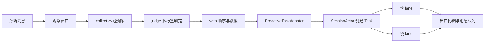

# 主动介入与 Task 提交

生效场景仍以 [SCENES.md](interests/SCENES.md) 为准，扩展边界见 [AGENT-CONTRACT.md](AGENT-CONTRACT.md)。当前运行架构见 [ARCHITECTURE](../../../docs/ARCHITECTURE.md)。

群聊观察窗口由 `main.ts` 持有，被动输入与主动判定共用；关闭主动介入后仍可向被 @ 的输入提供上下文。窗口纯内存，Task 创建时将选定窗口、回放和引用持久化。

| 模块                        | 所有权与公共接缝                                                                                  |
| --------------------------- | ------------------------------------------------------------------------------------------------- |
| `interests/pool.ts`         | 兴趣池加载、校验和本地匹配；`replaceEntries` 可替换来源                                           |
| `scene/collect.ts`          | 本地候选与证据，不调用模型                                                                        |
| `judge/judge.ts`            | 逐候选判据、JSON 输出契约及解析；不决定场景优先级                                                 |
| `judge/client.ts`           | 调用并发与错误降级；失败按本次沉默处理                                                            |
| `veto/veto.ts`              | `evaluateVeto` 纯函数，按 `SCENE_ORDER`、硬限流、session 闸门和 wait 策略裁决                     |
| `scene/state.ts`            | 问题台账、话题 session、wait 票据和预算剩余投影                                                   |
| `scene/watcher.ts`          | `observe` / `observeAddressed` / `stop`；管理三个触发面、同 Session 判定串行和定时器              |
| `task/proactive-adapter.ts` | `submit` / `delivered` / `settled`；冻结触发依据、引用、预算范围，提交 Task，首次成功记录实际发言 |
| `deliver/speaker.ts`        | dryRun 和旧接口回归的能力/降级适配；生产实际产物统一进入 MessageQueue                             |

| 触发面           | 时机                        | 场景               |
| ---------------- | --------------------------- | ------------------ |
| `message`        | 每条旁听消息                | 1 续聊追问、4 指代 |
| `question-probe` | 问题挂起默认 90 秒          | 3 无人应答         |
| `topic-roll`     | 默认 30 条消息或静默 5 分钟 | 2 持续讨论、5 兴趣 |

判定通过后预留一个主动 Task 单位，两个 lane 完整进入队列。正文、附件、存活提醒和失败通知不增加业务扣费；任一消息首次成功送达提交一次。完全静默、取消且没有待发产物，或全部投递终结且均失败，则释放预留。预算范围在触发时绑定，旧结果不扣新话题。`state.session.budgetLeft` 是 TaskBudget 的剩余额度投影。

主动结果依据触发时的授权发送，后来话题翻篇或问题已解答也不撤销。有可识别消息时保存其 ID、作者、时间和摘录；没有直接消息时保存触发上下文摘录。原引用与 QQ 的合法发送锚点分别存储。OneBot 用原生 `reply` 段，QQ 用 `message_reference`；不能原生引用的附件先发归属说明。

QQ 没有无锚点主动推送能力，Task 产物等待有效被动回复出口；OneBot 无平台回复窗口。尚未尝试的消息可以持久等待，已尝试的失败或超时消息不重发，每条失败通知仅尝试一次。发送不检查 Task 是否已经完成。

配置位于 `config/proactive.yml`。`enabled` 代码默认 false、`dryRun` 默认 true，共享配置可显式覆盖；白名单仅由 `BOT_LISTEN_GROUPS` 提供。`sessionBudget` 默认 2、硬上限 5，单位为 Task；`sessionIdleMs` 默认 10 分钟，`sessionMinGapMs` 默认 45 秒。`judgeTimeoutMs` 默认 20 秒；执行时限由 `tasks.fastTimeoutMs` / `slowTimeoutMs` 控制，旧 `speakTimeoutMs` 不再生效。wait 默认最多让路一次、45 秒重查，先检查对象存活和转录新增以节约判定调用。

健康与指标分别展示 `proactive` 的场景/话题/wait 统计、`tasks` 的两 lane 队列，以及 `messages` 的投递状态。`spoke` / `spokeInSession` 统计首次实际成功送达的 Task，附件数量不影响它们。旧话题关闭后的迟到结果仍归旧预算范围。

验收：`tests/proactive-*.test.ts` 覆盖原有 collect/judge/veto；`tests/task-system.test.ts` 覆盖主动 Task、旧引用、跨话题发送、多产物一次扣费、静默与失败释放、取消后队列结算。
